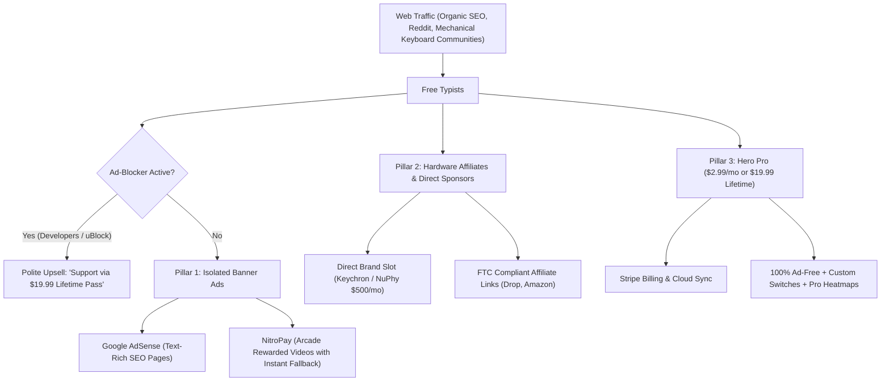
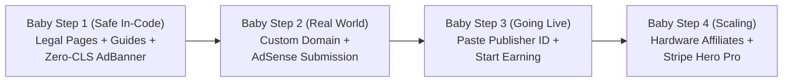

# Keyboard Hero: Commercialization & Monetization Blueprint

This blueprint outlines how to turn **Keyboard Hero** into a sustainable, high-revenue web application through a beginner-friendly, step-by-step approach. It covers **legal requirements**, **ad integration**, **mechanical keyboard affiliate commerce**, and **Pro freemium subscriptions**, without compromising typing performance or input latency.

---

## 1. How Website Monetization Works (The Plain-English Overview)

When you run a modern web app:
1. You apply for a free account with an advertising network (most universally, **Google AdSense**).
2. The ad network gives you a Publisher ID (e.g., `ca-pub-1234567890`).
3. You place lightweight ad boxes on your website in designated peripheral zones.
4. When visitors practice typing, advertisers pay for impressions (views) and clicks.
5. The ad network collects those advertiser payments and **deposits them directly into your bank account** once a month.

---

## 2. The 3-Pillar Hybrid Model

Pure banner ad models on niche webapps typically earn **\$1.50 to \$4.00 RPM** (revenue per 1,000 pageviews). A 100,000-pageview/month app might only earn \$200–\$400/month on banners alone. 

By contrast, combining **banner ads + Pro micro-subscriptions + mechanical keyboard affiliate links + direct sponsorships** elevates revenue potential to **\$15.00–\$45.00 RPM** (\$1,500–\$4,500+/month).

---

## 3. Critical "Watch Outs" & Technical Caveats

### A. AdSense Approval for SPAs & Interactive Games
> [!WARNING]
> **AdSense Thin Content Risk**: Google AdSense crawlers look for structured, high-value written text. Single-Page Applications (SPAs) and bare canvas games are frequently rejected for *"Thin Content"* or *"No Value."*

- **The Solution (Content-Rich Educational Guide Pages)**:
  - We do **NOT** submit the interactive `/arcade` or `/learn` practice routes to Google AdSense initially.
  - Instead, we build clean, text-rich, educational guide pages with substantial written advice, finger placement diagrams, and FAQs before embedding the practice widget:
    - **`/guides/how-to-touch-type`**: "The Beginner's Guide to Blind Touch-Typing" (ergonomics, homing bumps, posture, muscle memory development).
    - **`/guides/dvorak`**: "Ergonomic Typing: Dvorak vs QWERTY" (finger travel analysis, transition timeline).
    - **`/guides/programmer-typing`**: "Touch-Typing for Developers" (brackets, syntax, terminal shortcuts).
  - These pages establish domain authority and provide crawled text that passes AdSense review easily.

### B. Web Rewarded Video Constraints & Bulletproof Fallbacks
> [!IMPORTANT]
> **Web Rewarded Video Reality**: AdSense does not cleanly support web rewarded video. Furthermore, ad-blockers or low fill rates will cause rewarded ad requests to fail. The game must **NEVER** freeze or stall waiting for an ad callback that will never arrive.

- **The Solution (Fail-Safe Graceful Fallback)**:
  - Implement a strict **3.0-second timeout** on rewarded ad initialization:
    - If the ad fills and plays $\rightarrow$ Grant reward (+1 Shield in Word Invaders / +10s in C4 Defusal).
    - If the ad fails, times out, or is blocked by uBlock $\rightarrow$ Execute graceful bypass:
      `"Sponsor video currently unavailable. Here is your bonus shield anyway!"`
    - The player is never penalized or locked out.

### C. FTC Affiliate Compliance
> [!NOTE]
> Embedding affiliate links (Amazon Associates, Keychron, Drop) into sound switchers or heatmaps without disclosure can result in account bans.

- **The Solution**:
  - Always place a clear, tasteful FTC disclosure nearby:
    *`"Keyboard Hero may earn an affiliate commission on qualifying hardware purchases at no additional cost to you."`*

---

## 4. Beginner-Friendly Baby Steps Roadmap

To make this completely safe and approachable with zero prior experience, we break development down into 4 clear stages:

### Baby Step 1: Legal Compliance & Safe In-Code Foundation (100% Free & Safe)
*Goal: Prepare the web application with everything Google AdSense legally requires, without needing any ad account or credit card yet.*
- [ ] **Legal Pages (`/privacy` and `/terms`)**:
  - Comprehensive, standard Privacy Policy explaining local storage, Dexie.js data, cookies, and privacy rights.
  - Standard Terms of Service protecting your app and user guidelines.
  - Footer navigation links to these legal pages.
- [ ] **Content-Rich Guide Article (`/guides/how-to-touch-type`)**:
  - Educational, well-written article explaining home row anchors, posture, tactile homing bumps, and blind muscle memory.
  - Gives Google AdSense crawlers real, high-value text to index.
- [ ] **Zero-CLS `<AdBanner />` Placeholder Component**:
  - Resilient component reserving fixed height (`728x90` on desktop, `320x50` on mobile) so ads never cause layout jumps or input lag.
  - In development mode (before AdSense approval), it displays a quiet, elegant supporter badge or typing tip.
  - Detects active ad-blockers and politely displays the respectful supporter note instead of an annoying blocker wall.

### Baby Step 2: Real-World Preparation (When You're Ready)
*Goal: Acquire a clean custom domain and submit your application to Google AdSense.*
- [ ] **Connect a Custom Domain**:
  - Register a domain (e.g. `keyboardhero.app` or `keyboardhero.io` for ~$10–$14/year) on Porkbun, Namecheap, or Vercel Domains.
  - Point DNS records to Vercel production.
- [ ] **Submit to Google AdSense**:
  - Create a free Google AdSense account.
  - Submit the domain using your guide URL (`https://yourdomain.com/guides/how-to-touch-type`).
  - Google verifies your site (typically 24–72 hours).

### Baby Step 3: Going Live & Earning First Revenue
*Goal: Turn on live advertising and see your first earnings.*
- [ ] **Set AdSense Publisher ID in Environment Variables**:
  - Add `NEXT_PUBLIC_ADSENSE_CLIENT_ID=ca-pub-XXXXXXXXXXXX` in `.env.local` and Vercel Project Settings.
- [ ] **Place Safe Peripheral Ad Slots**:
  - **Slot 1**: Practice Lab (`/learn`) footer (below the virtual keyboard, isolated from the typing canvas).
  - **Slot 2**: Session Summary Scorecard Modal (shown while user reviews their completed WPM and accuracy).
  - **Slot 3**: Arcade Hub (`/arcade`) top banner.
- [ ] **Add `public/ads.txt`**: Standard verification file required by Google to prevent counterfeit ad inventory.

### Baby Step 4: Scaling & Expansion (Future Revenue Boosters)
*Goal: Multiply revenue beyond banner ads with hardware links and Pro memberships.*
- [ ] **FTC-Compliant Mechanical Keyboard Affiliate Links**:
  - Add subtle sponsor cards in the Sound Theme Switcher (Keychron V1, Drop barebones, tactile switches) with FTC disclosure.
- [ ] **Hero Pro Supporter Pass (Stripe)**:
  - Allow users to pay \$2.99/mo or \$19.99 lifetime for 100% ad-free experience, custom switch sound profiles, and cloud backups.
- [ ] **Classroom Edu Tier**:
  - \$49/year teacher package for computer labs.
